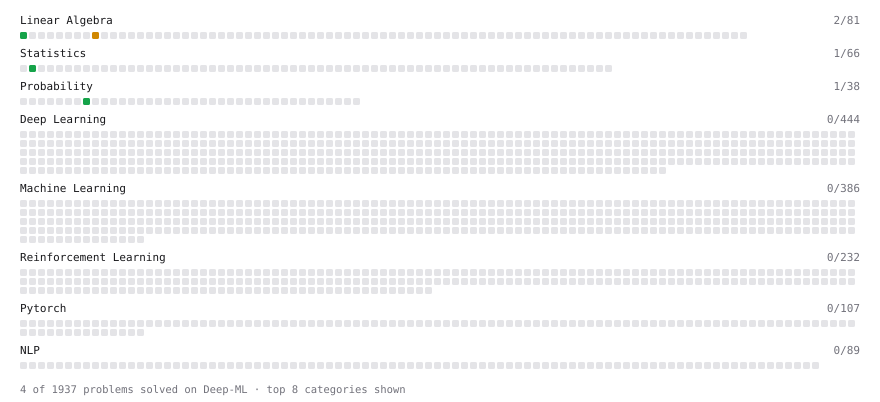

# Deep-ML

My machine learning practice from [Deep-ML](https://www.deep-ml.com). Every solution here was written by hand.

**9** solved · 5 problems · 0 labs · 4 math

[**Browse the interactive portfolio**](https://KUSH2005-IND.github.io/deep-ml/) to replay this filling in over time.

## Problems

| | Difficulty | Solved | |
| --- | --- | --- | --- |
| [Descriptive Statistics Calculator](https://www.deep-ml.com/problems/78) | easy | 2026-11-09 | [solution](problems/0078-descriptive-statistics-calculator) |
| [Empirical Probability Mass Function (PMF)](https://www.deep-ml.com/problems/184) | easy | 2026-11-09 | [solution](problems/0184-empirical-probability-mass-function-pmf) |
| [Expected Value and Variance of an n-Sided Die](https://www.deep-ml.com/problems/179) | easy | 2026-11-09 | [solution](problems/0179-expected-value-and-variance-of-an-n-sided-die) |
| [Matrix-Vector Dot Product](https://www.deep-ml.com/problems/1) | easy | 2026-10-05 | [solution](problems/0001-matrix-vector-dot-product) |
| [Matrix times Matrix ](https://www.deep-ml.com/problems/9) | medium | 2026-10-05 | [solution](problems/0009-matrix-times-matrix) |

## Math

| | Difficulty | Solved | |
| --- | --- | --- | --- |
| [Descriptive Statistics](https://www.deep-ml.com/math-problems/18) | easy | 2026-11-05 | [solution](math/0018-descriptive-statistics) |
| [Expectation and Variance Algebra](https://www.deep-ml.com/math-problems/33) | easy | 2026-11-05 | [solution](math/0033-expectation-and-variance-algebra) |
| [Gradient Descent Updates](https://www.deep-ml.com/math-problems/5) | easy | 2026-10-07 | [solution](math/0005-gradient-descent-updates) |
| [Probability Fundamentals](https://www.deep-ml.com/math-problems/19) | easy | 2026-11-05 | [solution](math/0019-probability-fundamentals) |

---

_This file is regenerated by Deep-ML on every push._
